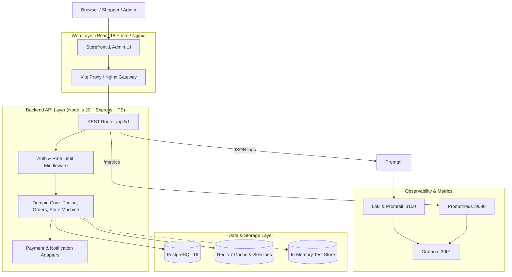
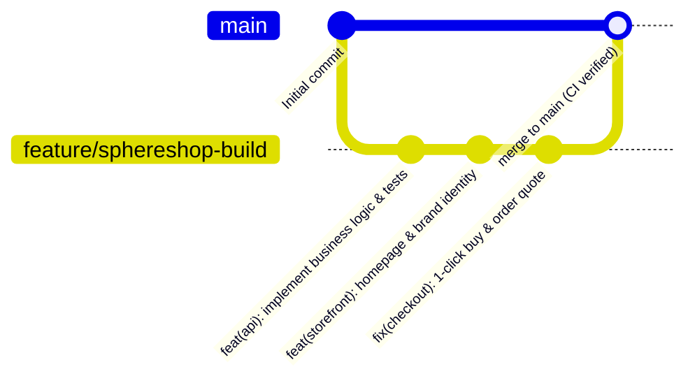
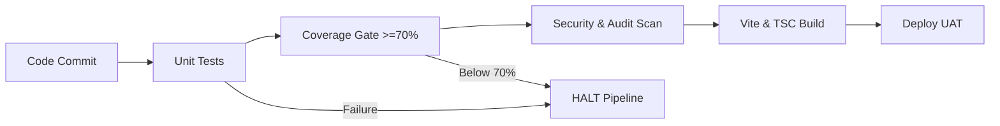

# SphereShop — Enterprise E-Commerce & Service-Booking Platform
**Cloud Sphere Solutions · Kigali, Rwanda**

[](.gitlab-ci.yml)
[-success?logo=jest)](api/package.json)
[](api/coverage/lcov-report/index.html)
[](docker-compose.yml)
[-emerald)](docs/ASSUMPTIONS.md)
[-orange)](docs/ASSUMPTIONS.md)

---

## 1. Project Overview & Architecture

SphereShop is an end-to-end, containerized e-commerce and device-setup service booking platform built for **Cloud Sphere Solutions** in Kigali, Rwanda. The solution combines a modern high-conversion storefront, a robust REST API, full observability, and an automated CI/CD deployment pipeline.



### Core Business Constraints & Kigali Rules
- **Currency & Rounding**: **RWF** (Rwandan Francs). Every computed amount is floored to the nearest whole franc (`Math.floor`). No decimals are rendered. Thousands separators are formatted per Rwandan retail standards (e.g., `12,000 RWF`).
- **Time Zone**: **Africa/Kigali (UTC+2)**. Express delivery cut-off is strictly **14:00 Kigali Time**.
- **Delivery Districts**: Enforced at the district level (**Gasabo**, **Kicukiro**, **Nyarugenge**). Orders outside these zones are routed to Store Pickup (`0 RWF`).
- **Delivery Pricing**: Standard delivery is `1,500 RWF` (Free if net after coupon is $\ge 40,000\text{ RWF}$ or shopper is Loyal with $\ge 5$ delivered orders). Express delivery is `3,500 RWF` (never free).
- **Stock Reservation**: Inventory reservations hold for **10 minutes** from initial checkout order placement (`PENDING_PAYMENT`).

---

## 2. Engineering & Development Workflow

### Prerequisites
- **Node.js**: `v20.x` or higher
- **npm**: `v10.x` or higher
- **Docker & Docker Compose** (for multi-container deployment & observability)

### Workspace Structure
```
cloudsphere/
├── api/                  # Express REST API (TypeScript, Winston, Jest)
│   ├── src/
│   │   ├── domain/       # Core business logic (pricing, order state machine)
│   │   ├── routes/       # Express routes (auth, catalogue, checkout, etc.)
│   │   ├── services/     # Payment, notifications, and store services
│   │   └── tests/        # Unit & Integration test suites
├── web/                  # React 18 Storefront (Vite, TypeScript, Vanilla CSS)
│   ├── src/
│   │   ├── components/   # Reusable UI components (Navbar, Hero, Benefits, etc.)
│   │   ├── context/      # StoreContext, Cart state, Auth state
│   │   ├── pages/        # Storefront pages (Home, ProductDetail, Checkout, etc.)
├── observability/        # Prometheus, Grafana dashboards, Loki, Promtail
├── k8s/                  # Kubernetes production manifests (Ingress, Deployments, HPA)
├── perf/                 # k6 performance & stress testing scripts
├── security/             # OWASP vulnerability and injection probe scripts
├── scripts/              # Backup, restore, and operational runbook scripts
├── docker-compose.yml    # Full-stack container orchestration
├── .gitlab-ci.yml        # Multi-stage CI/CD pipeline definition
└── package.json          # Root workspace scripts (concurrent execution)
```

---

### Step 1: Clone & Install Dependencies

```bash
# Clone the repository
git clone https://github.com/Kaliza-e/SphereShop.git
cd SphereShop

# Install workspace, backend, and frontend dependencies
npm install
npm --prefix api install
npm --prefix web install
```

---

### Step 2: One-Command Local Development

You can start both the backend API and frontend storefront concurrently with live reloading and synchronized color-coded console logs:

```bash
# From workspace root
npm run dev
```

| Service | Local URL | Description |
|---|---|---|
| **Web Storefront** | [http://localhost:5173](http://localhost:5173) | Vite dev server with Hot Module Replacement (HMR) |
| **REST API** | [http://localhost:3001](http://localhost:3001) | Express API running via `ts-node-dev` with auto-reload |
| **API Health Check** | [http://localhost:3001/health](http://localhost:3001/health) | Returns `{"status":"ok"}` (SEC-11 compliant) |
| **API Metrics** | [http://localhost:3001/metrics](http://localhost:3001/metrics) | Prometheus-compatible metrics endpoint |

> **Vite Proxy Note**: The frontend Vite server automatically proxies `/api/*` requests directly to `http://localhost:3001`, preventing CORS friction during local development.

#### Running Services Separately

If you prefer isolated terminal sessions:

```bash
# Terminal 1: Backend API (Port 3001)
npm run dev:api
# Or: cd api && npm run dev

# Terminal 2: Frontend Web (Port 5173)
npm run dev:web
# Or: cd web && npm run dev
```

---

## 3. Git & Branching Workflow

We adhere to a Trunk-based / Feature Branch workflow coupled with the **Conventional Commits** specification.



### Branch Conventions
- `main`: Production-ready branch. Direct pushes are restricted; updates require passing CI pipelines.
- `feature/*`: Feature branches for active development (e.g. `feature/sphereshop-build`).
- `fix/*`: Bug fixes and hotfix branches.

### Commit Message Format
```
<type>(<scope>): <short summary>

[optional body with bullet points]
```
- **Types**: `feat`, `fix`, `test`, `refactor`, `perf`, `docs`, `chore`.
- **Example**:
  ```bash
  git commit -m "feat(storefront): redesign homepage to reference, unify brand identity, and fix end-to-end checkout"
  ```

---

## 4. Testing, Verification & Quality Gate Workflow

Quality assurance is automated and gated at multiple levels:



### 1. API Test Suite & Coverage (Jest)
Runs all unit and integration test suites covering pricing calculation, line discounts, coupons, delivery zones, order state machine transitions, and payment adapters:

```bash
# Run full API test suite with coverage
npm --prefix api test

# Or run specific test slices:
npm --prefix api run test:unit
npm --prefix api run test:integration
```

**Quality Thresholds Enforced**:
- Global Statement Coverage: $\ge 70\%$ (Achieved: **87.94%**)
- Global Line Coverage: $\ge 70\%$ (Achieved: **90.97%**)
- Branch Coverage: $\ge 70\%$ (Achieved: **77.41%**)
- Function Coverage: $\ge 70\%$ (Achieved: **86.36%**)

### 2. Frontend Test Suite & Production Bundle
Verifies component rendering, user events, and TypeScript type soundness:

```bash
# Run Vitest web tests
npm --prefix web run test

# Validate production build bundle
npm --prefix web run build
```

### 3. Programmatic Checkout & Buy Verification
Test the entire shopping cycle end-to-end (add item $\to$ get quote $\to$ authenticate $\to$ create order):

```bash
# Test API checkout quote calculation
curl -s "http://localhost:3001/api/v1/checkout/quote?district=Gasabo&deliveryMethod=standard"

# Test order status retrieval
curl -s "http://localhost:3001/api/v1/orders/SS-20261020-0001"
```

---

## 5. CI/CD Pipeline Workflow (`.gitlab-ci.yml`)

The GitLab CI/CD pipeline enforces strict gating before any artifact reaches the deployment stage:

```yaml
stages:
  - build      # TypeScript compilation & Vite bundle creation
  - test       # Jest unit tests, coverage verification, npm audit, secret scan
  - deploy     # Kubernetes deployment to UAT cluster
```

### Pipeline Safety Guarantee
1. **Compilation Check**: `api/dist` and `web/dist` artifacts are built in clean Node 20 environments.
2. **Automated Test Gate**: If any unit test or integration scenario fails, or if code coverage drops below $70\%$, the `unit_test_coverage_job` exits with code 1.
3. **Deployment Halt**: Upon test failure, the `deploy_uat` stage is immediately skipped, preventing defective code from reaching UAT or production.
4. **Vulnerability & Secret Scanning**: Audits high/critical npm packages and prevents accidental commits of API keys or credentials.

---

## 6. Multi-Container Orchestration (`docker-compose.yml`)

Run the complete, production-grade microservice environment locally with PostgreSQL, Redis, and observability tooling:

```bash
# Start all containers in the background
docker compose up -d

# Check running container status
docker compose ps

# Tail logs across all services
docker compose logs -f
```

### Container Port Mapping

| Service | Container Port | Host Port | Purpose |
|---|---|---|---|
| **web** | `80` | `80` | Nginx reverse proxy serving the React static bundle |
| **api** | `3000` | `3000` | Express REST API connected to Postgres & Redis |
| **db** | `5432` | `5432` | PostgreSQL 16 Alpine database |
| **redis** | `6379` | `6379` | Redis 7 Alpine cache & session store |
| **prometheus** | `9090` | `9090` | Metrics scraper collecting `/metrics` |
| **grafana** | `3000` | `3001` | Pre-configured Golden Signals dashboard (`admin` / `admin`) |
| **loki** | `3100` | `3100` | Centralized JSON log aggregation engine |
| **promtail** | — | — | Log collector feeding Winston logs into Loki |

---

## 7. Kubernetes Deployment Workflow (`k8s/`)

The repository includes declarative Kubernetes manifests for staging and production deployments:

```bash
# Validate manifests with client-side dry-run
kubectl apply -f k8s/ --dry-run=client

# Deploy to active cluster namespace
kubectl apply -f k8s/

# Monitor deployment rollout
kubectl -n sphereshop rollout status deployment/sphereshop-api
kubectl -n sphereshop rollout status deployment/sphereshop-web

# Inspect Horizontal Pod Autoscalers (HPA)
kubectl -n sphereshop get hpa
```

Manifests included in [`k8s/`](k8s/):
- `configmap.yaml` & `secret.yaml`: Environment configuration and credentials.
- `api-deployment.yaml` & `web-deployment.yaml`: Replicated Pod specifications with health probes (`livenessProbe`, `readinessProbe`).
- `services.yaml` & `ingress.yaml`: ClusterIP services and Nginx Ingress routing.
- `hpa.yaml`: Horizontal Pod Autoscaler targeting CPU and memory utilization.

---

## 8. Operational Runbooks & Maintenance

Operational bash scripts are provided in [`scripts/`](scripts/) for maintenance and chaos testing:

```bash
# 1. Database Backup (creates timestamped pg_dump archive)
bash scripts/backup.sh

# 2. Database Restore (restores from archive with verification)
bash scripts/restore.sh <backup_file.sql.gz>

# 3. CPU Stress Simulation (validates HPA auto-scaling behavior)
bash scripts/stress-cpu.sh

# 4. Error Rate Generation (triggers HTTP 500 alerts for Grafana/Alertmanager testing)
bash scripts/generate-errors.sh
```

### Performance & Security Probes
```bash
# Run k6 checkout load benchmark (100 VU stress test)
k6 run perf/k6_checkout_stress.js

# Run SQL injection and XSS probe suite
bash security/injection_probes.sh
```

---

## 9. Seed Personas & Demo Credentials

The database auto-seeds on initial launch with 28 products and pre-configured test personas:

| Role | Persona | Identifier / Phone | Email | Password | Purpose |
|---|---|---|---|---|---|
| **Standard Shopper** | Aline | `0781000001` | `aline@spheretest.rw` | `Kigali2026` | Standard cart & checkout validation |
| **Loyal Shopper** | Eric | `0791000002` | `eric@spheretest.rw` | `Kigali2026` | Qualifies for free standard delivery ($\ge 5$ orders) |
| **Locked Account** | Locked User | `0721000003` | `locked@spheretest.rw` | `Kigali2026` | Validates 15-minute lock after 5 bad password attempts |
| **Store Admin** | Ops Admin | `0788000000` | `ops@spheretest.rw` | `Kigali2026` | Access to Admin dashboard and order management |
| **Delivery Agent** | Delivery Agent | `0789000000` | `agent@spheretest.rw` | `Kigali2026` | Order dispatching and status transitions |

> **Quick Login Shortcut**: On the web checkout page (`/checkout`), click **"⚡ Quick 1-Click Demo Login"** to sign in instantly as Aline without entering credentials manually.

---

## 10. Documentation Index

Detailed architectural and regulatory documentation:

- [`rtm.csv`](rtm.csv) — **Requirement Traceability Matrix** (119 UAT scenarios mapped to code and test IDs)
- [`docs/UAT_EXECUTION_LOG.md`](docs/UAT_EXECUTION_LOG.md) — Empirical UAT execution log and scenario validation
- [`docs/ASSUMPTIONS.md`](docs/ASSUMPTIONS.md) — Architecture choices, pricing algorithms, and design assumptions
- [`docs/API.md`](docs/API.md) — REST endpoint specifications, request schemas, and response samples
- [`docs/ADMIN_QUICKSTART.md`](docs/ADMIN_QUICKSTART.md) — Non-technical operations guide for staff and admins
- [`docs/K8S.md`](docs/K8S.md) — Kubernetes deployment, storage configuration, and scaling guide
- [`docs/OBSERVABILITY.md`](docs/OBSERVABILITY.md) — Prometheus metrics, Loki log collector, and Grafana dashboard guide
- [`docs/PERF_RESULTS.md`](docs/PERF_RESULTS.md) — k6 load testing and concurrency benchmark results
- [`docs/SECURITY_RESULTS.md`](docs/SECURITY_RESULTS.md) — OWASP Top 10 security audit and penetration results
- [`docs/PIPELINE_EVIDENCE.md`](docs/PIPELINE_EVIDENCE.md) — CI/CD pipeline proof and test failure barrier evidence

---

## 11. Support & Contact

**Cloud Sphere Solutions Ltd.**  
KG 7 Ave, Kigali, Rwanda  
Email: `support@cloudspheretech.rw` | Phone: `+250 788 000 000`
